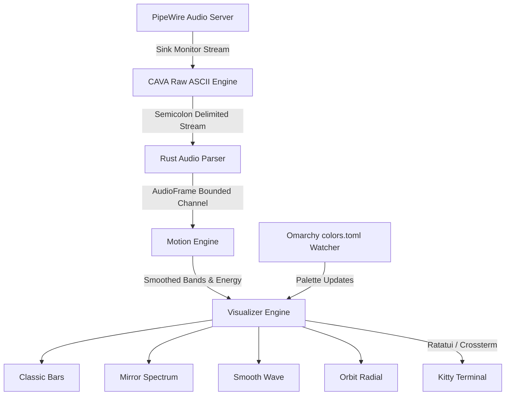

# ⚡ chiviz

> **Omarchy-Native Audio Visualizer** crafted specifically for Omarchy, Kitty Terminal, and PipeWire.

`chiviz` is a high-performance, real-time terminal audio spectrum visualizer. It transforms your system's PipeWire audio into fluid, responsive animations inside Kitty and Hyprland, automatically syncing with your active Omarchy theme.

---

## 🌟 Highlights

- **Native PipeWire Capture**: Seamlessly monitors system output (e.g. Chrome, YouTube, Spotify, ALSA) through PipeWire sink monitors without recording microphones or interrupting audio streams.
- **Dynamic Device Switching**: Automatically tracks PipeWire default sink changes (AirPods Pro ⇄ Built-in Speakers ⇄ HDMI) and gracefully reconnects.
- **Precision Motion Engine**:
  - Instant attack and exponential decay release curves
  - Floating peak indicators with simulated gravity falloff
  - Spatial frequency smoothing
  - Dynamic rolling normalization for balanced dynamic contrast
  - Frame queue dropping to eliminate latency accumulation
- **Dual Visual Collections (4 Modes)**:
  - 📻 **Retro Collection**:
    - **Classic Bars**: High spectrum bars, peak hold caps, 1/8th Unicode sub-block precision.
    - **Mirror Spectrum**: Symmetrical top-bottom reflection with dimmed water mirror effect.
  - 🔮 **Modern Collection**:
    - **Smooth Wave**: Ultra-high-resolution continuous waveform using 2×4 Unicode Braille sub-pixel matrices.
    - **Orbit**: Circular radial spectrum with aspect ratio correction; bass pulses the core radius, treble ripples the outer perimeter.
- **Omarchy Theme Engine**: Automatically parses `~/.local/state/omarchy/current/theme/colors.toml` and hot-reloads on system theme changes. Includes Tokyo Night, Catppuccin, Neon Synth, and Winamp Retro presets.
- **Dual Layouts**:
  - **Compact / Tiled**: Optimized for Hyprland split panes with ultra-slim status line, dynamic bar reduction, and zero horizontal overflow.
  - **Immersive**: Edge-to-edge visualization for fullscreen Kitty windows with minimal floating badges.
- **Self-Diagnostic Doctor**: Built-in `chiviz --doctor` diagnoses Kitty capabilities, PipeWire status, default sinks, CAVA streams, and Omarchy themes.

---

## 📐 Architecture



---

## 🚀 Quick Start

### Prerequisites

Ensure `cava` and `pipewire` are installed on your Arch / Omarchy system:

```bash
# Arch Linux / Omarchy
sudo pacman -S cava pipewire wireplumber
```

### Installation

```bash
git clone https://github.com/chiv/chiviz.git
cd chiviz
cargo build --release
sudo cp target/release/chiviz /usr/local/bin/
```

---

## 🎮 Keyboard Controls

| Key | Action |
|:---|:---|
| `1` | Switch to **Classic Bars** |
| `2` | Switch to **Mirror Spectrum** |
| `3` | Switch to **Smooth Wave** |
| `4` | Switch to **Orbit** |
| `m` / `n` | Cycle next visualizer mode |
| `p` | Cycle previous visualizer mode |
| `Tab` | Cycle next theme |
| `Shift+Tab` / `BackTab` | Cycle previous theme |
| `f` | Toggle Immersive / Compact layout |
| `+` / `=` | Increase sensitivity |
| `-` / `_` | Decrease sensitivity |
| `Space` | Freeze / Resume animation |
| `?` / `h` | Toggle help overlay |
| `q` / `Esc` | Quit |

---

## 🛠️ CLI Options

```bash
# Start with default settings (follows Omarchy theme & PipeWire output)
chiviz

# Run system doctor diagnostics
chiviz --doctor

# List all available PipeWire output devices
chiviz --list-devices

# Launch specific mode directly
chiviz --mode orbit
chiviz --mode wave
chiviz --mode mirror
chiviz --mode classic

# Launch by collection
chiviz --collection modern
chiviz --collection retro

# Select theme
chiviz --theme auto
chiviz --theme tokyonight
chiviz --theme catppuccin
chiviz --theme neon
chiviz --theme winamp

# Select layout
chiviz --layout compact
chiviz --layout immersive

# Run synthetic music demo (no audio setup required)
chiviz --demo

# Customize framerate, bars, sensitivity
chiviz --framerate 60 --bars 64 --sensitivity 1.2
```

---

## 🩺 System Doctor (`chiviz --doctor`)

Run `chiviz --doctor` at any time to verify your system audio pipeline:

```text
=== chiviz Environment Doctor ===

[PASS] Terminal: Kitty & TrueColor capability
       • TERM = xterm-kitty
       • Kitty binary: kitty 0.49.2
       • TrueColor Support: true

[PASS] Audio Server: PipeWire & WirePlumber running
       • PipeWire 'pipewire-0' [1.6.9]
       • wpctl command accessible and communicating with daemon

[PASS] Output Device: Default audio output discovered
       • Active Default Sink: Chiv的AirPods Pro (ID: 81)
       • Volume: 20%
       • Total Available Sinks: 3

[PASS] CAVA Engine: CAVA installed and verified
       • Path: /usr/bin/cava
       • Version: cava 1.0.0

[PASS] Live Capture: PipeWire -> CAVA -> ASCII stream verified
       • Received 15 test frames from CAVA raw PipeWire output
       • Active audio detected! Real spectrum pipeline verified.

[PASS] Omarchy Theme: Omarchy colors.toml detected & parsed
       • Theme Name: vantablack
       • Gradient stops: 6 colors

✨ All system checks passed! chiviz is fully ready for Omarchy.
```

---

## 🧪 Verification & Testing

Run the test suite and quality checks:

```bash
cargo fmt --check
cargo clippy --all-targets -- -D warnings
cargo test
cargo build --release
```

---

## 📄 License

MIT License. Designed with pride for Omarchy.
