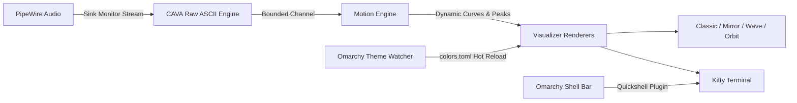

<div align="center">


# ⚡ chiviz

**Omarchy-Native Audio Visualizer & Quickshell Bar Widget**  
*Crafted for Omarchy, Kitty Terminal, Hyprland, and PipeWire.*

[](LICENSE)
[](Cargo.toml)
[](manifest.json)
[](https://omarchy.org)
[](https://pipewire.org)

[English](README.md) · [简体中文](README_zh.md)

</div>

---

`chiviz` is a high-performance, real-time terminal audio spectrum visualizer and Omarchy shell plugin. Rather than a standalone media player, it is an **audio-reactive engine** that passively intercepts system PipeWire audio (YouTube, Spotify, games, or browser streams) and renders fluid, ultra-smooth visualizations synchronized with your active Omarchy theme in Kitty and Hyprland.

---

## 🌟 Highlights & Key Features

- 🎧 **Passive PipeWire Capture**: Intercepts output sink monitors without occupying microphones, interrupting active streams, or demanding microphone permissions.
- 🔄 **Dynamic Device Failover**: Seamlessly handles headphone disconnects/reconnects (AirPods Pro ⇄ Internal Speakers ⇄ HDMI) with instant auto-recovery.
- ⚙️ **Precision Motion Engine**:
  - Instant attack curves with natural exponential decay.
  - Floating peak hold indicators with simulated gravity falloff.
  - Dynamic rolling normalization to prevent clipping and low-volume idling.
  - Ring buffer queue-dropping to completely eliminate latency accumulation.
- 🎨 **Omarchy Theme Synchronization**: Automatically monitors `~/.local/state/omarchy/current/theme/colors.toml` and hot-reloads palettes live without restarting.
- 🧩 **Omarchy Shell Bar Widget**: Ships with an official Quickshell bar widget (`chiv.chiviz`) for one-click launching, floating window summon, and audio-reactive status.
- 🩺 **Built-in System Doctor (`--doctor`)**: Diagnoses Kitty capabilities, PipeWire nodes, default sinks, CAVA streams, and Omarchy theme paths in one command.

---

## 🖼️ Visual Showcase & Modes

`chiviz` features two design collections across 4 mathematical visualization modes:

### 1. 📻 Classic Bars (`--mode classic`)
*High-density spectrum bars with floating peak caps and 1/8th Unicode sub-block precision.*

```text
  80 dB ┤                                        ▔
        │                        ▔       █             ▔
        │                █       █       █       █     █
        │        █       █   █   █   █   █   █   █ █   █   █
        │    █   █ █ █   █ █ █ █ █ █ █ █ █ █ █ █ █ █ █ █ █ █ █
   0 dB ┴────┴───┴─┴─┴───┴─┴─┴─┴─┴─┴─┴─┴─┴─┴─┴─┴─┴─┴─┴─┴─┴─┴─┴─┴───
        50Hz        250Hz        1kHz         4kHz        16kHz
```

### 2. 🌊 Mirror Spectrum (`--mode mirror`)
*Symmetrical top-bottom frequency reflection with attenuated water-mirror ripple decay.*

```text
        │        █       █       █       █       █
        │    █   █ █ █   █ █ █ █ █ █ █ █ █ █ █ █ █ █ █
  ──────┼────┴───┴─┴─┴───┴─┴─┴─┴─┴─┴─┴─┴─┴─┴─┴─┴─┴─┴─┴────────── (Centerline)
        │    ░   ▒ ░ ░   █ ▒ ░ ▒ █ ▒ ░ ▒ █ ▒ ░ ▒ █ ░ ░
        │        ░       ▒       ▒       ░       ░
```

### 3. 〰️ Smooth Wave (`--mode wave`)
*Continuous multi-harmonic waveform rendered with 2×4 Unicode Braille sub-pixel matrices.*

```text
        ⡀                                   ⢄
       ⢠⠃⠣⡀                                ⠳⡄
      ⢠⠃   ⠱⡄     ⢠⠞⠙⣆                    ⠹⣄
  ───⠤⠊───────⠘⠢⠤⠤⠞─────⠈⠢⠤⠤⠖⠊⠑⠢⠤⠤⠴⠒⠊⠉⠙⠢⠤⠴⠒⠊⠉⠙⠒─────
```

### 4. 🪐 Orbit Radial (`--mode orbit`)
*Circular radial spectrum with 2:1 terminal aspect ratio correction; bass pulses the core radius while treble ripples the perimeter.*

```text
                          ⠘⡆ ⡞⠃
                     ⢀⠤⠒⠈⠉⠁⠒⠤⡀
                  ⡠⠊   ⢀⠤⠒⠤⡀   ⠑⠢⢄
                ⢰⠁    ⢎  ⚡  ⡱     ⠈⡆
                ⠈⡄    ⠈⠢⠤⠔⠁     ⢠⠃
                  ⠑⠤⣀   ⣀⠤⠒⠤⣀   ⢀⠤⠊
                     ⠈⠉⠁    ⠈⠉⠁
                           ⠱⡄ ⢠⠎
```

---

## 📐 Pipeline & Architecture




---

## ⚡ Omarchy Plugin Marketplace

`chiviz` conforms to the **Omarchy Shell Plugin v1** manifest specification (`manifest.json`) and is ready for the [Omarchy Plugin Marketplace](https://plugins.omarchy.org).

### Install via Omarchy CLI

```bash
# 1. Add and enable the plugin directly into Omarchy shell
omarchy plugin add https://github.com/chivopic/chiviz.git --enable

# 2. Build and install the binary (if not already on PATH)
cd ~/.config/omarchy/plugins/chiv.chiviz
cargo build --release
sudo cp target/release/chiviz /usr/local/bin/
```

### Bar Widget Controls

The integrated bar widget (`󰎈`) provides quick interaction:
- **Left Click**: Launch or focus the running Chiviz window (`omarchy-launch-or-focus-tui`).
- **Right Click**: Launch system diagnostic doctor (`chiviz --doctor`).
- **Middle Click**: Launch Chiviz in a floating window.

---

## 🚀 Manual Installation & Build

### System Dependencies

```bash
# Arch Linux / Omarchy
sudo pacman -S cava pipewire wireplumber kitty
```

### Build from Source

```bash
git clone https://github.com/chivopic/chiviz.git
cd chiviz
cargo build --release

# Install executable to system path
sudo install -m 755 target/release/chiviz /usr/local/bin/
```

---

## 🎮 Keybindings

| Key | Action |
|:---|:---|
| `1` | Switch to **Classic Bars** |
| `2` | Switch to **Mirror Spectrum** |
| `3` | Switch to **Smooth Wave** |
| `4` | Switch to **Orbit Radial** |
| `Space` / `m` / `n` | Cycle next visualizer mode (with top toast notification) |
| `p` | Cycle previous visualizer mode |
| `Tab` | Cycle next theme preset |
| `Shift+Tab` | Cycle previous theme preset |
| `f` | Toggle Immersive mode / Compact mode |
| `+` / `=` | Increase sensitivity |
| `-` / `_` | Decrease sensitivity |
| `s` | Freeze / Resume animation |
| `?` / `h` | Toggle keyboard help modal |
| `q` / `Esc` | Quit Chiviz |

---

## 🛠️ CLI Options

```bash
# Default launch (auto-follows active Omarchy theme and default PipeWire sink)
chiviz

# Run built-in diagnostics & health check
chiviz --doctor

# Test visualizers with synthetic demo audio (no PipeWire/CAVA required)
chiviz --demo

# List available PipeWire audio sinks
chiviz --list-devices

# Launch specific mode directly
chiviz --mode wave
chiviz --mode orbit
chiviz --mode mirror
chiviz --mode classic

# Custom frame rate, bars, and sensitivity
chiviz --framerate 60 --bars 64 --sensitivity 1.25

# Select theme override
chiviz --theme tokyonight
chiviz --theme catppuccin
chiviz --theme neon
chiviz --theme winamp
```

---

## 🪟 Hyprland Integration

Add the following rule to `~/.config/hypr/rules.conf` or `~/.config/hypr/looknfeel.lua` to make floating visualizers seamlessly snap to center:

```ini
# Floating window rule for Chiviz
windowrulev2 = float, class:^(org.omarchy.chiviz-float|chiviz-float)$
windowrulev2 = size 900 480, class:^(org.omarchy.chiviz-float|chiviz-float)$
windowrulev2 = center, class:^(org.omarchy.chiviz-float|chiviz-float)$
```

---

## 📄 License

Distributed under the **MIT License**. See [LICENSE](LICENSE) for details.  
Crafted with pride for **Omarchy** and the Linux audio enthusiast community.
