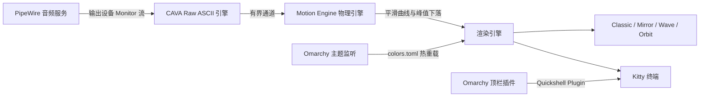

<div align="center">


# ⚡ chiviz — Omarchy 原生终端音频可视化工具与顶栏插件

**专为 Omarchy、Kitty 终端、Hyprland 与 PipeWire 量身打造的高性能实时音频频谱可视化应用**

[](LICENSE)
[](Cargo.toml)
[](manifest.json)
[](https://omarchy.org)
[](https://pipewire.org)

[English](README.md) · [简体中文](README_zh.md)

</div>

---

`chiviz` 不是音乐播放器，而是一款基于系统声音驱动的音频响应式（Audio-Reactive）终端应用与 Omarchy 状态栏插件。它能被动捕获 PipeWire 音频输出的 monitor 流（例如正在播放的 Chrome / YouTube、Spotify、网易云等），以极低延迟驱动动态频谱，并在 Kitty 终端中平滑绘制，同时无缝融入 Omarchy 系统的颜色主题与顶栏控制流。

---

## 🌟 核心特性

- 🎧 **原生 PipeWire 输出捕获**：监听输出设备的 monitor 流，绝不占用麦克风、不干扰正在播放的 Chrome / AirPods 音频，无需麦克风权限。
- 🔄 **输出设备无感切换与自动重连**：无论耳机断开回退至内置扬声器，还是重新戴上 AirPods，自动检测 PipeWire 默认 Sink 变更并秒级无缝恢复。
- ⚙️ **高品质 Motion Engine 动态物理引擎**：
  - Attack / Release 毫秒级瞬时起音与自然对数衰减。
  - Peak Hold 峰值漂浮线与模拟重力加速度平滑下落。
  - 动态滚动归一化（Dynamic Normalization），避免声音过大过载或声音微弱时无反应。
  - 环形缓冲主动丢弃过期帧，彻底杜绝延迟累积。
- 🎨 **Omarchy 主题实时无缝联动**：
  - 读取 `~/.local/state/omarchy/current/theme/colors.toml`。
  - 监控主题文件热更新，运行时切换 Omarchy 主题无需重启应用或中断音频。
  - 内置 Tokyo Night、Catppuccin Mocha、Neon Synth、Winamp Retro 等预设。
- 🧩 **Omarchy Shell 状态栏插件**：内置 Quickshell 顶栏组件（`chiv.chiviz`），支持一键启动、窗口聚焦、右键系统体检。
- 🩺 **系统自检诊断器（`--doctor`）**：一键检测 Kitty 版本、PipeWire 状态、输出 Sink、CAVA 原生流以及 Omarchy 主题配置。

---

## 🖼️ 四大视觉模式展示

`chiviz` 包含两大系列，共计 4 种精细设计的可视化算法：

### 1. 📻 经典柱状模式 Classic Bars (`--mode classic`)
*高频谱柱、顶端峰值漂浮线、1/8 字符块级精细分辨率。*

```text
  80 dB ┤                                        ▔
        │                        ▔       █             ▔
        │                █       █       █       █     █
        │        █       █   █   █   █   █   █   █ █   █   █
        │    █   █ █ █   █ █ █ █ █ █ █ █ █ █ █ █ █ █ █ █ █ █ █
   0 dB ┴────┴───┴─┴─┴───┴─┴─┴─┴─┴─┴─┴─┴─┴─┴─┴─┴─┴─┴─┴─┴─┴─┴─┴─┴───
        50Hz        250Hz        1kHz         4kHz        16kHz
```

### 2. 🌊 镜像频谱模式 Mirror Spectrum (`--mode mirror`)
*上下对称反射，下方模拟水面波纹衰减倒影。*

```text
        │        █       █       █       █       █
        │    █   █ █ █   █ █ █ █ █ █ █ █ █ █ █ █ █ █ █
  ──────┼────┴───┴─┴─┴───┴─┴─┴─┴─┴─┴─┴─┴─┴─┴─┴─┴─┴─┴─┴────────── (中轴线)
        │    ░   ▒ ░ ░   █ ▒ ░ ▒ █ ▒ ░ ▒ █ ▒ ░ ▒ █ ░ ░
        │        ░       ▒       ▒       ░       ░
```

### 3. 〰️ 平滑波形模式 Smooth Wave (`--mode wave`)
*利用 2×4 Unicode 盲文点阵（Braille）打造连续高分辨率波形曲线（基于频谱多重谐波合成）。*

```text
        ⡀                                   ⢄
       ⢠⠃⠣⡀                                ⠳⡄
      ⢠⠃   ⠱⡄     ⢠⠞⠙⣆                    ⠹⣄
  ───⠤⠊───────⠘⠢⠤⠤⠞─────⠈⠢⠤⠤⠖⠊⠑⠢⠤⠤⠴⠒⠊⠉⠙⠢⠤⠴⠒⠊⠉⠙⠒─────
```

### 4. 🪐 圆形环轨模式 Orbit Radial (`--mode orbit`)
*低音驱动内环呼吸式扩张，高频激荡外环边缘细节，内置终端字符 2:1 宽高比校正。*

```text
                          ⠘⡆ ⡞⠃
                     ⢀⠤⠒⠈⠉⠁⠒⠤⡀
                  ⡠⠊   ⢀⠤⠒⠤⡀   ⠑⠢⢄
                ⢰⠁    ⢎  ⚡  ⡱     ⠈⡆
                ⠈⡄    ⠈⠢⠤⠔⠁     ⢠⠃
                  ⠑⠤⣀   ⣀⠤⠒⠤⣀   ⢀⠤⠊
                     ⠈⠉⠁    ⠈⠉⠁
                           ⠱⡄ ⢠⠎
```

---

## 📐 系统架构与数据流




---

## ⚡ Omarchy 插件市场接入

`chiviz` 完全遵循 **Omarchy Shell Plugin v1** 清单规范（`manifest.json`），已通过 `omarchy plugin validate` 本地验证，可随时接入 [Omarchy 插件市场](https://plugins.omarchy.org)。

### 一键通过 Omarchy 安装与启用

```bash
# 1. 直接通过 omarchy 插件命令安装并激活
omarchy plugin add https://github.com/chivopic/chiviz.git --enable

# 2. 编译并安装主二进制程序至系统 PATH
cd ~/.config/omarchy/plugins/chiv.chiviz
cargo build --release
sudo cp target/release/chiviz /usr/local/bin/
```

### 顶栏组件交互功能

顶栏组件图标（`󰎈`）支持多种交互：
- **鼠标左键**：一键唤醒并聚焦 Chiviz 终端（已运行时直接聚焦，未运行时自动拉起）。
- **鼠标右键**：打开独立的 Chiviz 自检诊断工具（`chiviz --doctor`）。
- **鼠标中键**：以悬浮窗模式（Floating Window）启动 Chiviz。

---

## 🚀 手动安装与编译

### 系统依赖准备

```bash
# Arch Linux / Omarchy
sudo pacman -S cava pipewire wireplumber kitty
```

### 从源码编译安装

```bash
git clone https://github.com/chivopic/chiviz.git
cd chiviz
cargo build --release

# 拷贝至系统可执行路径
sudo install -m 755 target/release/chiviz /usr/local/bin/
```

---

## 🎮 键盘快捷键

| 按键 | 功能说明 |
|:---|:---|
| `1` | 切换为 **Classic Bars（经典柱状）** |
| `2` | 切换为 **Mirror Spectrum（镜像频谱）** |
| `3` | 切换为 **Smooth Wave（平滑波形）** |
| `4` | 切换为 **Orbit Radial（圆形环轨）** |
| `m` / `n` | 切换下一模式 |
| `p` | 切换上一模式 |
| `Tab` | 切换下一主题配色 |
| `Shift+Tab` | 切换上一主题配色 |
| `f` | 切换沉浸模式（Immersive）/ 平铺模式（Compact） |
| `+` / `=` | 提高灵敏度 |
| `-` / `_` | 降低灵敏度 |
| `Space` | 暂停 / 继续动画（不影响系统声音播放） |
| `?` / `h` | 打开 / 关闭快捷键帮助弹窗 |
| `q` / `Esc` | 退出 Chiviz |

---

## 🛠️ 常用命令行参数

```bash
# 默认启动（跟随当前 Omarchy 主题与当前 PipeWire 播放设备）
chiviz

# 运行系统诊断自检
chiviz --doctor

# 使用合成测试音频运行演示（无需 PipeWire/CAVA 捕获）
chiviz --demo

# 列出所有 PipeWire 音频输出设备
chiviz --list-devices

# 直接指定模式
chiviz --mode wave
chiviz --mode orbit
chiviz --mode mirror
chiviz --mode classic

# 自定义频段数、帧率与灵敏度
chiviz --bars 64 --framerate 60 --sensitivity 1.25

# 强制指定预设主题
chiviz --theme tokyonight
chiviz --theme catppuccin
chiviz --theme neon
chiviz --theme winamp
```

---

## 🪟 Hyprland 窗口联动配置

如需让 Chiviz 悬浮启动时居中并保持最佳比例，可在 `~/.config/hypr/rules.conf` 或 `~/.config/hypr/looknfeel.lua` 中加入如下规则：

```ini
# Chiviz 浮动窗口规则
windowrulev2 = float, class:^(org.omarchy.chiviz-float|chiviz-float)$
windowrulev2 = size 900 480, class:^(org.omarchy.chiviz-float|chiviz-float)$
windowrulev2 = center, class:^(org.omarchy.chiviz-float|chiviz-float)$
```

---

## 📄 开源许可证

本项目基于 **MIT License** 开源。详情参见 [LICENSE](LICENSE) 文件。  
Crafted with pride for **Omarchy** and Linux community.
