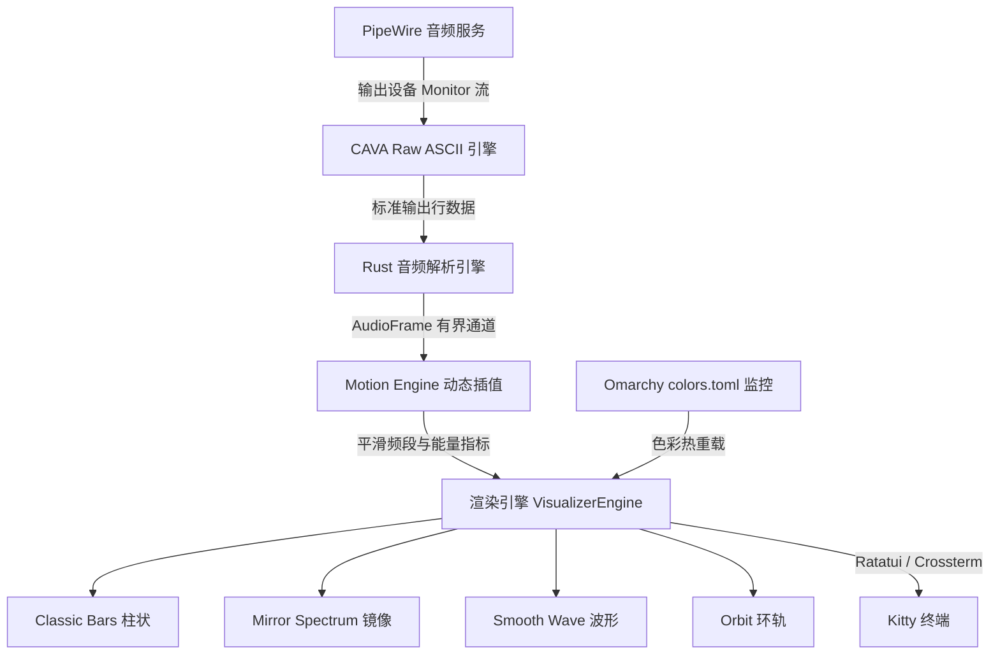

# ⚡ chiviz — Omarchy 原生终端音频可视化工具

> 专为 **Omarchy**、**Kitty 终端** 与 **PipeWire** 打造的高性能实时音频频谱可视化工具。

`chiviz` 不是音乐播放器，而是一款基于系统声音驱动的音频响应式（Audio-Reactive）终端应用。它能捕获 PipeWire 音频输出的 monitor 流（例如正在播放的 Chrome / YouTube、Spotify 等），以极低延迟驱动动态频谱，并在 Kitty 终端中平滑绘制，同时无缝融入 Omarchy 系统的颜色主题。

---

## 🌟 核心特性

- **原生 PipeWire 输出捕获**：监听输出设备的 monitor 流，绝不占用麦克风、不干扰正在播放的 Chrome / AirPods 音频，无需麦克风权限。
- **输出设备自动切换与重连**：无论耳机断开回退至内置扬声器，还是重新戴上 AirPods，自动检测 PipeWire 默认 Sink 变更并秒级无缝恢复。
- **高品质 Motion Engine 动态引擎**：
  - Attack / Release 毫秒级瞬时起音与自然对数衰减
  - Peak Hold 峰值保持与重力加速度下落
  - 动态峰值归一化（Dynamic Normalization），避免过载或声音微弱时无反应
  - 环形缓冲丢弃过期帧，彻底杜绝延迟累积
- **两套视觉系统（4 种模式）**：
  - 📻 **复古系列（Retro Collection）**：
    - **Classic Bars（经典柱状）**：高频谱柱、顶端峰值漂浮线、1/8 字符块级精细分辨率。
    - **Mirror Spectrum（镜像频谱）**：上下对称反射，下方模拟水面波纹衰减倒影。
  - 🔮 **现代系列（Modern Collection）**：
    - **Smooth Wave（平滑波形）**：利用 2×4 Unicode 盲文点阵（Braille）打造连续高分辨率波形曲线（基于频谱多重谐波合成）。
    - **Orbit（圆形环轨）**：低音驱动内环呼吸式扩张，高频激荡外环边缘细节，内置终端字符 2:1 宽高比校正。
- **Omarchy 主题实时无缝联动**：
  - 读取 `~/.local/state/omarchy/current/theme/colors.toml`。
  - 监控主题文件热更新，运行时切换 Omarchy 主题无需重启应用或中断音频。
  - 内置 Tokyo Night、Catppuccin Mocha、Neon Synth、Winamp Retro 等配色预设。
- **双布局模式**：
  - **Compact / 平铺窗口**：面向 Hyprland 平铺窗或分屏，单行极简状态，自适应减少频段数量，绝无横向溢出。
  - **Immersive / 沉浸全屏**：去除边框，全画布动画优先，右上角极简徽标。
- **系统自检诊断器（`--doctor`）**：一键检测 Kitty 版本、PipeWire 状态、输出 Sink、CAVA 原生流以及 Omarchy 主题配置。

---

## 📐 系统架构



---

## 🚀 快速上手

### 环境准备

在 Arch Linux / Omarchy 系统中确认安装基本依赖：

```bash
sudo pacman -S cava pipewire wireplumber
```

### 编译与安装

```bash
git clone https://github.com/chiv/chiviz.git
cd chiviz
cargo build --release
sudo cp target/release/chiviz /usr/local/bin/
```

---

## 🎮 键盘快捷键

| 按键 | 说明 |
|:---|:---|
| `1` | 切换为 **Classic Bars（经典柱状）** |
| `2` | 切换为 **Mirror Spectrum（镜像频谱）** |
| `3` | 切换为 **Smooth Wave（平滑波形）** |
| `4` | 切换为 **Orbit（环轨）** |
| `m` / `n` | 切换下一模式 |
| `p` | 切换上一模式 |
| `Tab` | 切换下一主题配色 |
| `Shift+Tab` | 切换上一主题配色 |
| `f` | 切换沉浸模式（Immersive）/ 平铺模式（Compact） |
| `+` / `=` | 提高灵敏度 |
| `-` / `_` | 降低灵敏度 |
| `Space` | 暂停 / 继续动画（不影响系统正在播放的声音） |
| `?` / `h` | 打开 / 关闭快捷键帮助弹窗 |
| `q` / `Esc` | 退出 |

---

## 🛠️ 常用命令行参数

```bash
# 默认启动（跟随当前 Omarchy 主题与当前 PipeWire 播放设备）
chiviz

# 运行系统诊断自检
chiviz --doctor

# 列出所有 PipeWire 音频输出设备
chiviz --list-devices

# 直接指定模式
chiviz --mode orbit
chiviz --mode wave
chiviz --mode mirror
chiviz --mode classic

# 按视觉风格启动
chiviz --collection modern
chiviz --collection retro

# 指定配色主题
chiviz --theme auto
chiviz --theme tokyonight
chiviz --theme catppuccin
chiviz --theme neon
chiviz --theme winamp

# 指定布局
chiviz --layout compact
chiviz --layout immersive

# 纯体验合成音频演示模式（无音频输出亦可体验）
chiviz --demo

# 自定义频段数、帧率与灵敏度
chiviz --bars 64 --framerate 60 --sensitivity 1.2
```

---

## 🩺 系统诊断 (`chiviz --doctor`)

运行 `chiviz --doctor` 可快速测试软硬件音频链路：

```text
=== chiviz Environment Doctor ===

[PASS] Terminal: Kitty & TrueColor capability
       • TERM = xterm-kitty
       • Kitty binary: kitty 0.49.2
       • TrueColor Support: true

[PASS] Audio Server: PipeWire & WirePlumber running
       • PipeWire 'pipewire-0' [1.6.9]
       • wpctl command accessible and communicating with daemon

[PASS] Output Device: Default audio output discovered
       • Active Default Sink: Chiv的AirPods Pro (ID: 81)
       • Volume: 20%
       • Total Available Sinks: 3

[PASS] CAVA Engine: CAVA installed and verified
       • Path: /usr/bin/cava
       • Version: cava 1.0.0

[PASS] Live Capture: PipeWire -> CAVA -> ASCII stream verified
       • Received 15 test frames from CAVA raw PipeWire output
       • Active audio detected! Real spectrum pipeline verified.

[PASS] Omarchy Theme: Omarchy colors.toml detected & parsed
       • Theme Name: vantablack
       • Gradient stops: 6 colors

✨ All system checks passed! chiviz is fully ready for Omarchy.
```

---

## 🧪 自动化测试与质量检验

```bash
cargo fmt --check
cargo clippy --all-targets -- -D warnings
cargo test
cargo build --release
```

---

## 📄 许可证

MIT License. Crafted with passion for Omarchy.
