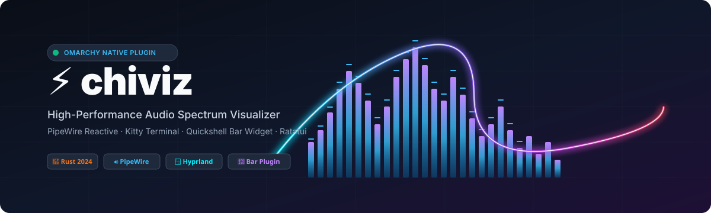
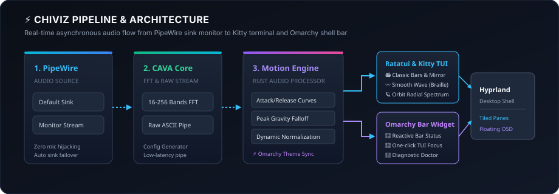

<div align="center">



# chiviz

**原生终端音频可视化工具与 Omarchy 状态栏插件**  
*专为 Omarchy、Kitty 终端、Hyprland 与 PipeWire 设计。*

[](LICENSE)
[](Cargo.toml)
[](manifest.json)
[](https://omarchy.org)

[English](README.md) · [简体中文](README_zh.md)

</div>

---

`chiviz` 是一款高性能的终端实时音频频谱可视化工具与 Omarchy 顶栏插件。它被动捕获系统 PipeWire 输出音频（网易云、Bilibili、Spotify、Chrome 等），在 Kitty 终端中平滑绘制频谱动画，并与 Omarchy 系统主题实时同步。

## 视觉模式

| 模式 | 快捷键 | 视觉系列 | 说明 |
|:---|:---:|:---|:---|
| **Classic Bars（经典柱状）** | `1` | 复古系列 | 高密度频谱柱，顶端峰值漂浮线，1/8 字符块级精细分辨率 |
| **Mirror Spectrum（镜像频谱）** | `2` | 复古系列 | 上下对称反射，带动态水面波纹涟漪与深水散射衰减倒影 |
| **Smooth Wave（平滑波形）** | `3` | 现代系列 | 2×4 Unicode 盲文连续曲线，多重谐波双轨回波与流光微粒填充 |
| **Orbit（圆形环轨）** | `4` | 现代系列 | 低音呼吸脉冲内核，多重雷达能量辐条与物理公转伴随卫星 |

### 1. Classic Bars 经典柱状
```text
  80 dB ┤                                        ▔
        │                        ▔       █             ▔
        │                █       █       █       █     █
        │        █       █   █   █   █   █   █   █ █   █   █
        │    █   █ █ █   █ █ █ █ █ █ █ █ █ █ █ █ █ █ █ █ █ █ █
   0 dB ┴────┴───┴─┴─┴───┴─┴─┴─┴─┴─┴─┴─┴─┴─┴─┴─┴─┴─┴─┴─┴─┴─┴─┴─┴───
        50Hz        250Hz        1kHz         4kHz        16kHz
```

### 2. Mirror Spectrum 镜像频谱
```text
        │        █       █       █       █       █
        │    █   █ █ █   █ █ █ █ █ █ █ █ █ █ █ █ █ █ █
  ──────┼────┴───┴─┴─┴───┴─┴─┴─┴─┴─┴─┴─┴─┴─┴─┴─┴─┴─┴─┴────────── (中轴线)
        │    ░   ▒ ░ ░   █ ▒ ░ ▒ █ ▒ ░ ▒ █ ▒ ░ ▒ █ ░ ░
        │        ░       ▒       ▒       ░       ░
```

### 3. Smooth Wave 平滑波形
```text
        ⡀                                   ⢄
       ⢠⠃⠣⡀                                ⠳⡄
      ⢠⠃   ⠱⡄     ⢠⠞⠙⣆                    ⠹⣄
  ───⠤⠊───────⠘⠢⠤⠤⠞─────⠈⠢⠤⠤⠖⠊⠑⠢⠤⠤⠴⠒⠊⠉⠙⠢⠤⠴⠒⠊⠉⠙⠒─────
```

### 4. Orbit 圆形环轨
```text
                          ⠘⡆ ⡞⠃
                     ⢀⠤⠒⠈⠉⠁⠒⠤⡀
                  ⡠⠊   ⢀⠤⠒⠤⡀   ⠑⠢⢄
                ⢰⠁    ⢎  ⚡  ⡱     ⠈⡆
                ⠈⡄    ⠈⠢⠤⠔⠁     ⢠⠃
                  ⠑⠤⣀   ⣀⠤⠒⠤⣀   ⢀⠤⠊
                     ⠈⠉⠁    ⠈⠉⠁
                           ⠱⡄ ⢠⠎
```

## 架构与核心特性



- **PipeWire 原生捕获**：监听音频输出设备的 Monitor 流，绝不占用麦克风、不干扰正在播放的音频。
- **设备无感热重连**：耳机断开或重连时（AirPods ⇄ 扬声器 ⇄ HDMI），自动切换并秒级恢复。
- **动态物理引擎**：瞬时起音与对数衰减、峰值重力下落，以及 $x^{0.72}$ 感知级非线性响度曲线（微弱声音与高潮鼓点同样清晰）。
- **Omarchy 主题热重载**：监控 `~/.local/state/omarchy/current/theme/colors.toml`，切换主题无需重启。
- **环境自检诊断器**：内置 `chiviz --doctor`，一键体检 Kitty、PipeWire、CAVA 引擎与主题状态。

## 安装指南

插件市场只会安装顶栏微件文件，不会构建或安装 `chiviz` 可执行文件。请先安装运行依赖并构建二进制，再启用微件。即使只想在终端中使用、不安装顶栏微件，也需要完成相同的二进制构建步骤。

### 1. 安装依赖并构建 Chiviz

在 Omarchy / Arch Linux 上安装 Rust 工具链和运行依赖（`rust` 软件包提供 Cargo）：

```bash
sudo pacman -S --needed rust cava pipewire wireplumber kitty
```

编译并安装可执行文件至 `~/.local/bin`：

```bash
git clone https://github.com/chivopic/chiviz.git
cd chiviz
cargo build --release
mkdir -p ~/.local/bin
install -m 755 target/release/chiviz "$HOME/.local/bin/chiviz"
```

请确认终端和 Omarchy 桌面会话的 `PATH` 都包含 `~/.local/bin`，然后重新打开终端/会话。可用以下命令检查二进制及依赖：

```bash
command -v chiviz
chiviz --doctor
```

### 2. 在终端中使用

完成上述构建后即可直接启动 Chiviz：

```bash
chiviz --demo
```

仅在终端使用不需要安装或启用顶栏插件。

### 3. 安装并启用顶栏插件

确认 `chiviz` 已安装，且 Omarchy 桌面会话的 `PATH` 能找到它之后，再安装并启用插件：

```bash
omarchy plugin add https://github.com/chivopic/chiviz.git --enable
```

顶栏左键、中键、右键分别启动可视化窗口、浮动模式和 `chiviz --doctor`。若微件无法在 `PATH` 中找到 `chiviz` 或 Kitty，会显示 Omarchy 通知并给出下一步操作，不会静默失败。

### 卸载

使用以下命令移除顶栏插件：

```bash
omarchy plugin remove chiv.chiviz --yes
```

移除插件不会删除手动构建的二进制。如需单独删除它，可运行：

```bash
rm -f ~/.local/bin/chiviz
```

## 快捷键映射

| 按键 | 功能说明 |
|:---|:---|
| `Space` / `m` / `n` | 循环切换下一视觉模式（顶部弹出居中悬浮提示） |
| `1` – `4` | 直接切换到柱状、镜像、波形或环轨模式 |
| `p` | 循环切换上一视觉模式 |
| `Tab` / `Shift+Tab` | 循环切换下一 / 上一主题配色 |
| `f` | 切换沉浸全屏模式 / 平铺紧凑模式 |
| `+` / `-` | 提高 / 降低灵敏度 |
| `s` | 暂停 / 继续动画（Freeze） |
| `?` / `h` | 打开 / 关闭快捷键帮助弹窗 |
| `q` / `Ctrl+C` | 退出程序 |

## 命令行参数

```bash
chiviz                         # 默认启动（跟随 PipeWire 默认输出设备与系统主题）
chiviz --mode wave             # 直接以指定模式启动 (classic, mirror, wave, orbit)
chiviz --theme tokyonight      # 强制指定预设主题
chiviz --demo                  # 使用内置合成音频演示
chiviz --doctor                # 运行环境诊断体检
chiviz --list-devices          # 查看所有 PipeWire 输出设备
```

## Hyprland 联动配置

在 `~/.config/hypr/rules.conf` 中追加浮动窗口规则：

```ini
windowrulev2 = float, class:^(chiviz-visualizer|chiviz-float)$
windowrulev2 = size 920 480, class:^(chiviz-visualizer|chiviz-float)$
windowrulev2 = center, class:^(chiviz-visualizer|chiviz-float)$
```

## 开源许可证

本项目基于 MIT License 开源。详见 [LICENSE](LICENSE) 文件。
